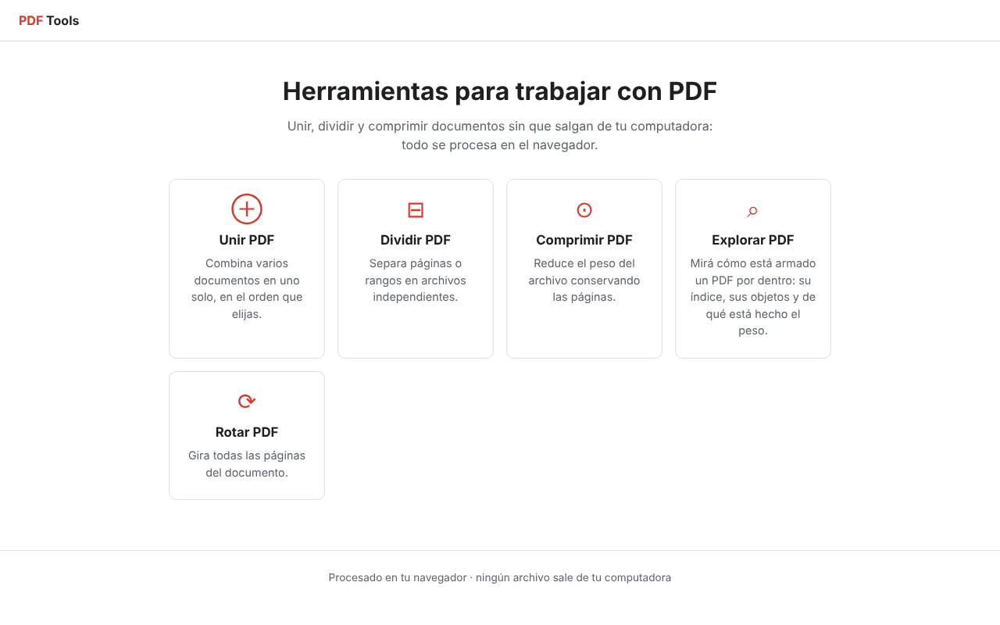

# PDF Tools

Herramientas para trabajar con archivos PDF **directamente en el navegador**: unir, dividir, comprimir, rotar y explorar documentos sin instalar nada y sin que los archivos salgan de tu computadora.

🔗 **Demo:** [ENLACE-DE-NETLIFY](https://pdftoolsdecintia1.netlify.app/)



## Funcionalidades

| Herramienta | Qué hace |
|---|---|
| **Unir PDF** | Combina varios documentos en uno, en el orden que elijas. |
| **Dividir PDF** | Separa páginas o rangos (`1-3,7,10-`) en archivos independientes. |
| **Comprimir PDF** | Reduce el peso con tres niveles: limpia metadatos, recomprime streams y, si se elige, recodifica imágenes a JPEG. |
| **Rotar PDF** | Gira todas las páginas 90°, 180° o 270°. |
| **Explorar PDF** | Muestra cómo está armado el archivo por dentro: versión, índice (xref), tráiler, objetos y de qué está hecho el peso. |

## Privacidad

Todo el procesamiento ocurre en el navegador con JavaScript. **No hay servidor**: los archivos nunca se suben a ningún lado.

## Tecnologías

- HTML, CSS y JavaScript sin frameworks
- [pdf-lib](https://pdf-lib.js.org/) para leer y escribir PDF
- Un lector de PDF propio (`js/motor/`) que interpreta la estructura interna del archivo: tabla xref clásica y comprimida, filtros FlateDecode, ASCII85, ASCIIHex y predictores PNG

## Estructura del proyecto

```
├── index.html
├── css/estilos.css
├── js/
│   ├── utilidades.js      # funciones chicas compartidas
│   ├── catalogo.js        # lista única de herramientas y sus opciones
│   ├── interfaz.js        # vistas, carga de archivos y resultados
│   ├── motor/             # lector de PDF hecho a mano
│   └── servicios/         # una herramienta por archivo
└── vendor/pdf-lib.min.js
```

La interfaz se arma a partir de `catalogo.js`. Para sumar una herramienta nueva alcanza con agregar una entrada en el catálogo y su archivo en `js/servicios/`: la interfaz no se toca.

## Cómo usarlo en tu computadora

No necesita instalación ni compilación:

```bash
git clone https://github.com/cintia84/NOMBRE-DEL-REPO.git
```

Después abrí `index.html` en el navegador.

## Autora

Hecho por **Cintia** · [GitHub](https://github.com/cintia84)
